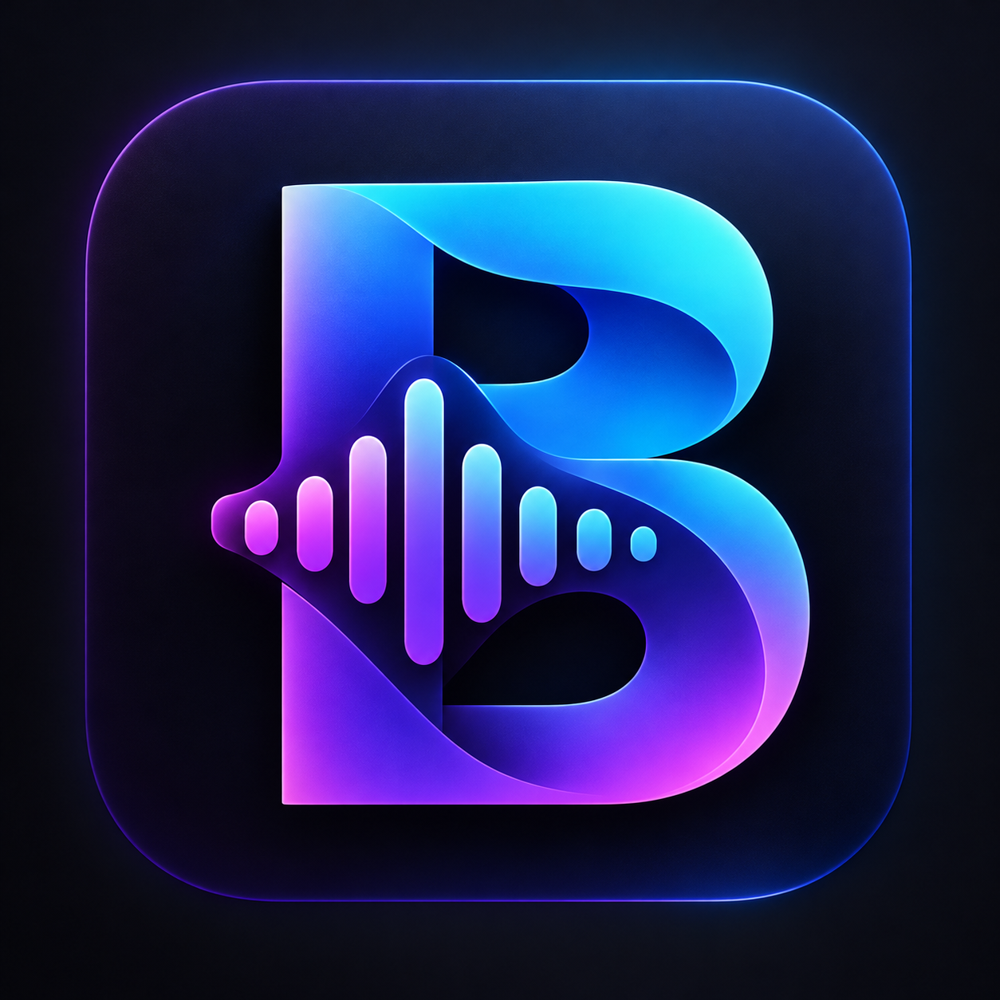

# Bitsonora

<p align="center">
  
</p>

<p align="center">
  <strong>A cross-platform desktop audio converter focused on batch conversion, metadata, and album artwork preservation.</strong>
</p>

<p align="center">
  <a href="https://github.com/malikalamsyah99/bitsonora">Source code</a> ·
  <a href="https://github.com/malikalamsyah99/bitsonora/issues">Report a bug</a> ·
  <a href="https://malikalamsyah99.github.io/">Developer website</a>
</p>

Bitsonora is a desktop audio converter built with Python, PySide6, and FFmpeg. It provides a graphical interface for converting multiple audio files to MP3, choosing output audio settings, and inspecting converted files. The project aims to preserve supported metadata and embedded album artwork while making batch conversion straightforward.

> **Project status:** Early development. The macOS application has been built and tested locally, including conversion from the packaged app and a DMG test package. Windows and Linux application packages have not yet been verified. macOS signing and notarization for public distribution are not configured yet.

## Contents

- [Highlights](#highlights)
- [Application preview](#application-preview)
- [Supported formats](#supported-formats)
- [Requirements](#requirements)
- [Quick start](#quick-start)
- [Running Bitsonora](#running-bitsonora)
- [Using the application](#using-the-application)
- [Output settings](#output-settings)
- [PSPMAN preset](#pspman-preset)
- [Metadata and album artwork](#metadata-and-album-artwork)
- [Output validation](#output-validation)
- [Project structure](#project-structure)
- [Development commands](#development-commands)
- [Building the macOS application](#building-the-macos-application)
- [Creating a macOS DMG](#creating-a-macos-dmg)
- [Build notes and distribution](#build-notes-and-distribution)
- [Troubleshooting](#troubleshooting)
- [Current limitations](#current-limitations)
- [Roadmap](#roadmap)
- [Contributing](#contributing)
- [Developer](#developer)
- [License](#license)

## Highlights

- **Batch conversion:** add multiple audio files or scan a folder for supported files.
- **Desktop GUI:** choose input files, output directory, bitrate, sample rate, and channel count without typing FFmpeg commands.
- **MP3 output:** select 128, 192, 256, or 320 kbps.
- **Sample-rate options:** choose 44,100 Hz or 48,000 Hz.
- **Mono or stereo output:** choose the desired output channel layout.
- **Metadata mapping:** pass source metadata to FFmpeg when converting.
- **Embedded cover art:** attempt to map optional embedded image streams into the MP3 output.
- **Post-conversion checks:** inspect the output with FFprobe and read common ID3 tags with Mutagen.
- **Per-file results:** show successful and failed files in the conversion log.
- **Batch resilience:** a failure for one file does not normally stop processing the remaining files.
- **Overwrite protection:** an output that already exists is not intentionally overwritten.
- **PSPMAN preset:** quickly select MP3, 44.1 kHz, stereo, and the default 192 kbps bitrate.
- **About dialog:** links to the developer profile, repository, and website.
- **Custom application branding:** the repository includes the Bitsonora PNG artwork and macOS ICNS/iconset assets.

## Application preview

The GUI includes file/folder selection, an output-directory field, conversion settings, a preset selector, progress indicator, a conversion log, and a **Help → About Bitsonora** menu.

Screenshots can be added to this section when they are committed to the repository. For now, the application logo above is the committed visual asset.

## Supported formats

### Input formats

The current input-file filter and conversion engine support these extensions:

| Format | Extension |
|---|---|
| MPEG-4 Audio | `.m4a` |
| Advanced Audio Coding | `.aac` |
| Waveform Audio | `.wav` |
| Free Lossless Audio Codec | `.flac` |
| Ogg audio | `.ogg` |
| Opus audio | `.opus` |

Actual decoding depends on the codecs enabled in the FFmpeg executable and the content of the source file. A file extension alone does not guarantee that every codec or metadata variation can be handled.

### Output format

The current application produces **MP3** files. Other output formats are not currently implemented in the GUI.

## Requirements

### For development from source

- Python 3.9 or newer
- PySide6
- Mutagen
- FFmpeg and FFprobe available to the application
- PyInstaller for packaging
- `static-ffmpeg` for the current helper script that fetches platform-specific executables

### For the tested macOS bundle

The current macOS packaging configuration places `ffmpeg` and `ffprobe` inside the application bundle. The bundled application has been tested locally on the developer's Mac. This should not be interpreted as confirmation that all macOS versions or other processor architectures have been tested.

Windows and Linux users can run from source after installing suitable FFmpeg/FFprobe executables, but packaged application builds for those platforms are not yet verified.

## Quick start

### 1. Clone the repository

```bash
git clone https://github.com/malikalamsyah99/bitsonora.git
cd bitsonora
```

### 2. Create a virtual environment

#### macOS and Linux

```bash
python3 -m venv .venv
source .venv/bin/activate
```

#### Windows PowerShell

```powershell
py -m venv .venv
.\.venv\Scripts\Activate.ps1
```

### 3. Install Python dependencies

From the repository root, run:

```bash
python -m pip install --upgrade pip
python -m pip install -e ".[dev]"
```

The editable install makes the `bitsonora` package importable from the `src` layout while working on the project.

### 4. Install FFmpeg for source development

#### macOS with Homebrew

```bash
brew install ffmpeg
```

#### Debian or Ubuntu Linux

```bash
sudo apt update
sudo apt install ffmpeg
```

#### Windows

Install an FFmpeg build that contains both `ffmpeg` and `ffprobe`, then make sure the executables are available on `PATH`. Consult the official FFmpeg download page for links to builds and platform information:

https://ffmpeg.org/download.html

Other Linux distributions may use a different package manager or package name.

### 5. Verify the environment

```bash
python -c "import PySide6, mutagen; print('Python dependencies OK')"
ffmpeg -version
ffprobe -version
```

The Python import command and both FFmpeg commands should complete successfully.

## Running Bitsonora

With the virtual environment active and the repository root as the working directory, launch the GUI with:

```bash
python -m bitsonora.main
```

The application entry point can also be launched with:

```bash
python run_bitsonora.py
```

## Using the application

1. **Add files:** click **Add Files** to select one or more audio files.
2. **Add a folder:** click **Add Folder** to select a directory containing supported audio files.
3. **Review inputs:** use **Remove Selected** or **Clear** to adjust the input list.
4. **Choose the output directory:** set the folder where converted MP3 files will be saved.
5. **Set audio options:** choose bitrate, sample rate, and mono/stereo output.
6. **Choose a preset if needed:** select the PSPMAN preset to apply its default settings.
7. **Convert:** click **Convert to MP3**.
8. **Review the result:** inspect progress, per-file log entries, the success/failure summary, and the output folder.

Folder scanning is non-recursive by default. Enable **Include subfolders when scanning folders** to include nested directories.

For safety, use an output folder separate from the source folder when practical. Bitsonora does not intentionally overwrite an existing output file; an existing destination is reported as a per-file failure so that prior output is not silently replaced.

## Output settings

### Bitrate

The GUI provides these MP3 bitrate choices:

- 128 kbps
- 192 kbps
- 256 kbps
- 320 kbps

A higher bitrate normally creates a larger file. Transcoding an already-lossy audio source to a higher bitrate does not restore audio information that was lost in the original encoding.

### Sample rate

Available options:

- 44,100 Hz
- 48,000 Hz

### Channels

Available options:

- Stereo (2 channels)
- Mono (1 channel)

The selected sample rate and channel count are applied during conversion and checked by the output validator.

## PSPMAN preset

Bitsonora includes the preset:

**PSPMAN - MP3 44.1 kHz Stereo**

Selecting it applies these default settings:

| Setting | Value |
|---|---|
| Output format | MP3 |
| Default bitrate | 192 kbps |
| Sample rate | 44,100 Hz |
| Channels | Stereo |

The bitrate can still be changed after selecting the preset. The preset targets the MP3 audio configuration used during local PSPMAN compatibility testing. Playback should still be checked on the target device; device behavior and metadata support can vary.

## Metadata and album artwork

The converter uses FFmpeg stream mapping and metadata mapping to carry supported source metadata and optional embedded picture streams into the MP3 output. The exact result depends on the source container, its tags, embedded image format, and FFmpeg's handling of those streams.

The metadata-inspection module uses Mutagen to read common ID3 fields, including:

- Title
- Artist
- Album
- Album artist
- Track number
- Date
- Genre
- Whether embedded cover artwork is detected
- Cover-art count and image MIME types

Artwork and metadata preservation have been verified on sample files during local development, but not on every possible source format or tag variant. The validator currently reports metadata/artwork information; it does not yet compare every tag in the source against the output or fail a conversion solely because artwork is absent.

## Output validation

After a file is converted, the batch engine invokes the validator. Current checks include:

- Output file exists and is non-empty.
- FFprobe can inspect the output.
- An audio stream is present.
- Audio codec is MP3.
- Sample rate matches the requested setting.
- Channel count matches the requested setting.
- Duration is positive.
- When FFprobe reports a bitrate, it is approximately within the configured target tolerance.
- Common ID3 metadata and cover-art presence are returned for inspection.

Validation helps detect common output issues. It is not a substitute for listening tests or compatibility testing on a target player. Bitrate reporting can vary for some MP3 streams, so the validator treats unavailable bitrate information differently from an explicit mismatch.

## Project structure

```text
bitsonora/
├── assets/
│   ├── bitsonora.png
│   ├── bitsonora.icns
│   └── Bitsonora.iconset/
├── src/
│   └── bitsonora/
│       ├── __init__.py
│       ├── main.py
│       ├── converter.py
│       ├── batch.py
│       ├── metadata.py
│       ├── validator.py
│       ├── resources.py
│       └── about.py
├── tests/
├── tools/
│   ├── fetch_ffmpeg.py
│   └── build_dmg.sh
├── .github/
│   └── workflows/
├── pyproject.toml
├── Bitsonora.spec
├── run_bitsonora.py
├── README.md
└── .gitignore
```

### Main modules

| File | Responsibility |
|---|---|
| `main.py` | PySide6 desktop GUI, settings, worker thread, and application entry point |
| `converter.py` | Single-file FFmpeg conversion and executable lookup |
| `batch.py` | Input scanning, batch conversion, and per-file result reporting |
| `metadata.py` | Inspection of MP3 ID3 tags and cover artwork using Mutagen |
| `validator.py` | Validation of MP3 codec, rate, channels, duration, and reported bitrate |
| `resources.py` | Locating application assets in development and PyInstaller contexts |
| `about.py` | About dialog and developer links |
| `tools/fetch_ffmpeg.py` | Fetches and verifies platform-specific FFmpeg/FFprobe executables for a build |
| `tools/build_dmg.sh` | Creates and verifies a macOS DMG containing the app and an Applications shortcut |
| `Bitsonora.spec` | PyInstaller bundle configuration |
| `pyproject.toml` | Project metadata, dependencies, and console entry point |

## Development commands

### Install development dependencies

```bash
python -m pip install -e ".[dev]"
```

### Run from source

```bash
python -m bitsonora.main
```

### Compile-check the Python source

```bash
python -m compileall -q src/bitsonora tools/fetch_ffmpeg.py
```

### Run automated tests

```bash
python -m pytest
```

The automated test suite is still being developed. The current repository has limited automated test coverage; a successful pytest run should not be interpreted as proof that all formats, metadata combinations, and operating systems have been tested.

## Building the macOS application

The current macOS bundle configuration includes FFmpeg and FFprobe under the app bundle. The build workflow below describes the project's current local packaging approach, not a signed/notarized release pipeline.

### 1. Install the build dependencies

Activate the project virtual environment and install the development extras:

```bash
python -m pip install -e ".[dev]"
```

### 2. Fetch FFmpeg and FFprobe

Run from the repository root:

```bash
python tools/fetch_ffmpeg.py
```

The script downloads/resolves platform-specific executables using `static-ffmpeg`, copies them into `vendor/ffmpeg/`, marks them executable on POSIX systems, and verifies that both can run. The `vendor/ffmpeg/` directory is ignored by Git because the binaries are downloaded as part of preparing a build.

Inspect the downloaded executables if needed:

```bash
ls -lh vendor/ffmpeg/
./vendor/ffmpeg/ffmpeg -version
./vendor/ffmpeg/ffprobe -version
```

### 3. Build the app bundle

```bash
python -m PyInstaller --noconfirm --clean Bitsonora.spec
```

Expected app bundle:

```text
dist/Bitsonora.app
```

Open the app with:

```bash
open dist/Bitsonora.app
```

Test launching the app and converting a sample file after each packaging change. Verify that the bundled `ffmpeg` and `ffprobe` are present inside the app bundle:

```bash
find dist/Bitsonora.app -type f \
  \( -name ffmpeg -o -name ffprobe \) -print
```

The macOS bundle has been tested locally on the developer's machine. Other macOS versions and processor architectures still require testing.

## Creating a macOS DMG

After building and testing `dist/Bitsonora.app`, create a DMG with:

```bash
./tools/build_dmg.sh
```

The script copies the app to a temporary staging directory, adds a symbolic link to `/Applications`, creates a compressed read-only disk image, and verifies the image.

Expected output:

```text
dist/Bitsonora-macOS.dmg
```

Open the DMG with:

```bash
open dist/Bitsonora-macOS.dmg
```

In Finder, drag `Bitsonora.app` to the `Applications` shortcut to install a copy. The mounted DMG is a separate location; eject it after installation. The build output under `dist/` is also a separate development copy.

## Build notes and distribution

- The present DMG is a local test package, not yet a signed and notarized public release.
- Apple Developer ID signing and notarization have not been configured.
- First-launch Gatekeeper behavior should be tested on a clean Mac before public distribution.
- The current FFmpeg fetching/build flow still needs a platform-by-platform release policy and broader testing before being used for Windows and Linux packages.
- Before redistributing FFmpeg binaries, review the exact binary build configuration and license obligations, and include all required notices. FFmpeg licensing varies with the libraries and options enabled in a particular build.
- The current workflow creates a macOS app bundle and DMG. It does not yet produce verified Windows installers or Linux packages.
- Do not upload `vendor/ffmpeg/`, `.venv/`, `build/`, or `dist/` to the source repository. These are local environment, downloaded executable, or build-output directories and are ignored by Git.

## Troubleshooting

### `ModuleNotFoundError: No module named 'bitsonora'`

From the repository root, with the virtual environment active, install the package in editable mode:

```bash
python -m pip install -e .
python -c "import bitsonora; print(bitsonora.__file__)"
```

### `ffmpeg` or `ffprobe` cannot be found

For development from source, install FFmpeg and make both executables available on `PATH`.

macOS/Linux:

```bash
which ffmpeg
which ffprobe
```

Windows:

```powershell
where.exe ffmpeg
where.exe ffprobe
```

For packaged builds, confirm that the binary files were fetched into `vendor/ffmpeg/` before building and that they were included in the application bundle.

### An output file already exists

Bitsonora does not intentionally overwrite an existing output file. Select another destination folder or handle the prior output before retrying.

### A file fails during conversion

Inspect the specific failure message in the conversion log. Verify that the source is readable, its extension is supported, and FFmpeg can decode its stream. A failed item should not normally prevent the rest of the batch from continuing.

### The app opens but conversion fails

Check whether the bundled `ffmpeg` and `ffprobe` executables exist and are executable. For a macOS bundle, use the `find` command in the build section to locate them. Rebuild after ensuring the expected binaries are available.

### Finder shows multiple copies of Bitsonora

The source build (`dist/Bitsonora.app`), an installed app (`/Applications/Bitsonora.app`), a staged copy (`build/dmg/Bitsonora.app`), and a mounted DMG copy (`/Volumes/Bitsonora/Bitsonora.app`) are separate copies. Keep the installed app for daily use, and eject the DMG when finished. The temporary staging directory can be removed after the DMG has been verified.

### macOS still displays an old icon

Confirm that the latest app was rebuilt and open the intended path. Finder and Dock may temporarily cache application icons.

### The app cannot be opened on another Mac

The current package is not yet a signed and notarized public release. Verify the build on a clean machine and configure appropriate signing/notarization before distributing broadly.

## Current limitations

- MP3 is currently the only implemented output format.
- Automated test coverage is limited and needs to be expanded.
- The metadata inspector focuses on common ID3 fields.
- Metadata and artwork are not yet compared field-by-field with the original source as a strict preservation test.
- Canceling a running batch is not implemented.
- Duplicate output filenames from different source directories can conflict when they are written to one output folder.
- Successful technical validation does not guarantee playback on every audio player or target device.
- macOS signing and notarization are not configured.
- Windows and Linux packaged builds have not yet been verified.
- The bundled FFmpeg licensing/notice workflow must be reviewed before public release.

## Roadmap

- [x] Build a PySide6 desktop GUI.
- [x] Convert batches of supported audio files to MP3.
- [x] Add bitrate, sample rate, and channel settings.
- [x] Add a PSPMAN preset.
- [x] Inspect common metadata and embedded cover artwork.
- [x] Validate key output audio properties with FFprobe.
- [x] Add a custom application icon and About dialog.
- [x] Build and test a local macOS app bundle.
- [x] Create a local macOS DMG test package.
- [x] Bundle FFmpeg and FFprobe in the tested macOS app build.
- [ ] Expand automated tests for conversion, metadata, and artwork.
- [ ] Compare source metadata against output metadata in preservation tests.
- [ ] Add safe cancellation for active batches.
- [ ] Handle duplicate output filenames across source directories.
- [ ] Review FFmpeg license obligations and include required notices.
- [ ] Sign and notarize the macOS release.
- [ ] Build and verify Windows packages.
- [ ] Build and verify Linux packages.
- [ ] Publish versioned releases through GitHub Releases.

## Contributing

Contributions, bug reports, and feature suggestions are welcome. Before opening a pull request:

1. Describe the issue or proposed change.
2. Test the relevant code path locally.
3. Include reproduction details for conversion or packaging failures.
4. Avoid committing local environments, downloaded FFmpeg binaries, or build outputs.

Open bug reports and feature requests through [GitHub Issues](https://github.com/malikalamsyah99/bitsonora/issues).

## Developer

**Malik Alamsyah**

- **GitHub profile:** https://github.com/malikalamsyah99
- **Bitsonora repository:** https://github.com/malikalamsyah99/bitsonora
- **Developer website:** https://malikalamsyah99.github.io/

## License

No project license file has been added yet. Until a license is selected and included, the repository does not explicitly grant permissions to reuse, modify, or redistribute the project code. Choose and add a license before inviting others to reuse the source. FFmpeg is a separate project and its binary license and notices must be assessed independently for the exact build being redistributed.
